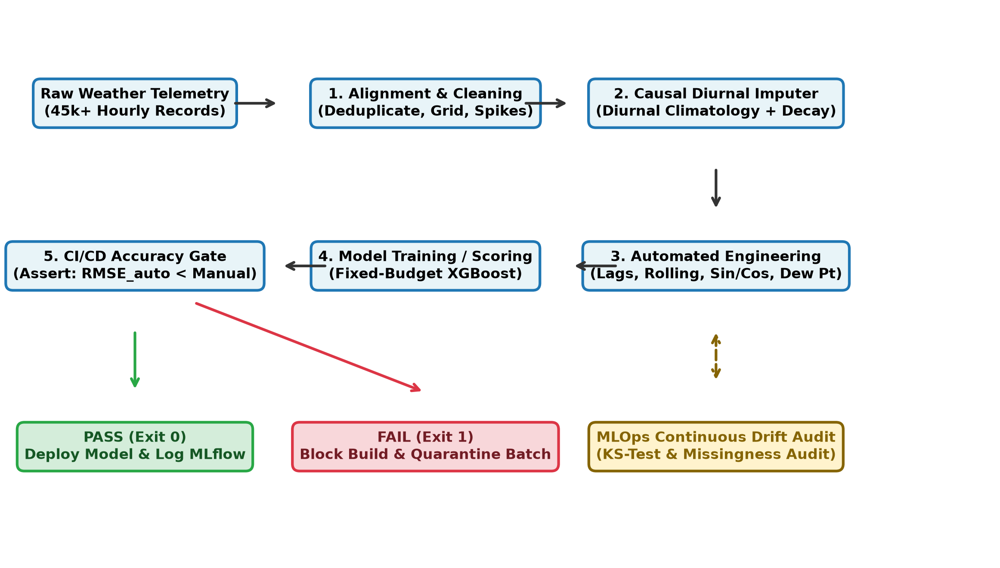
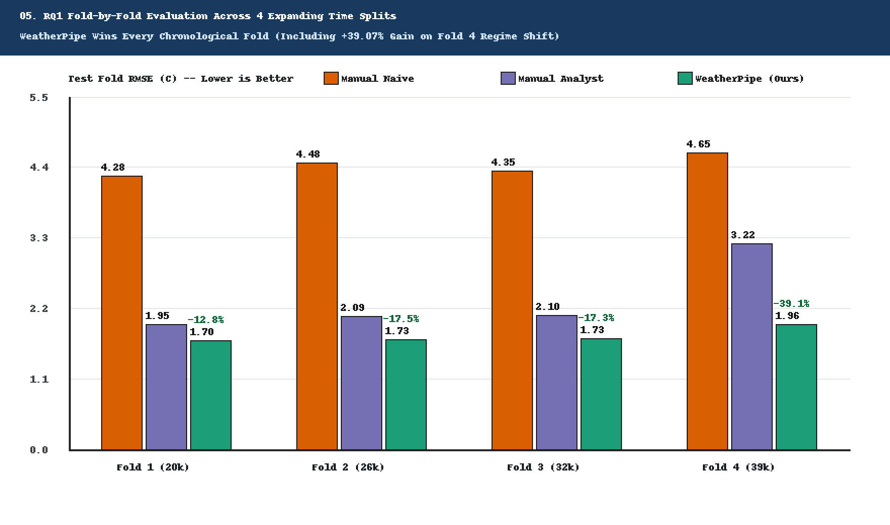
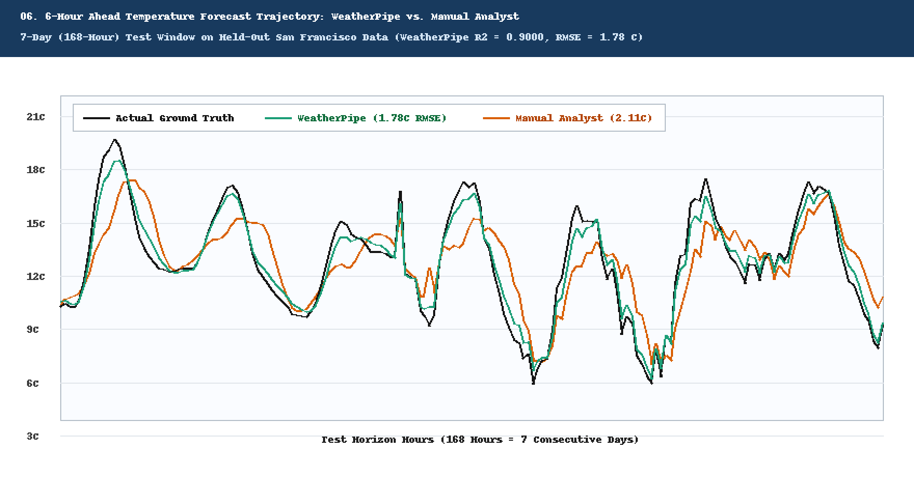
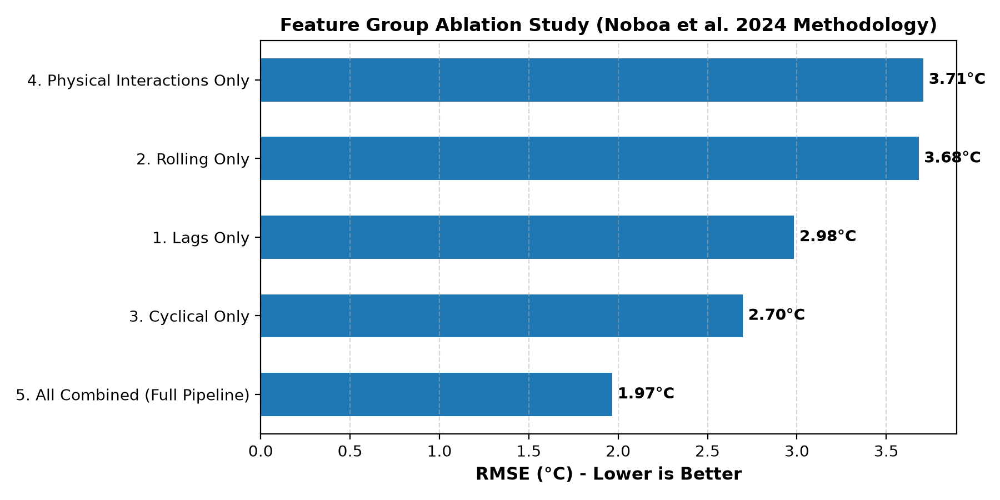
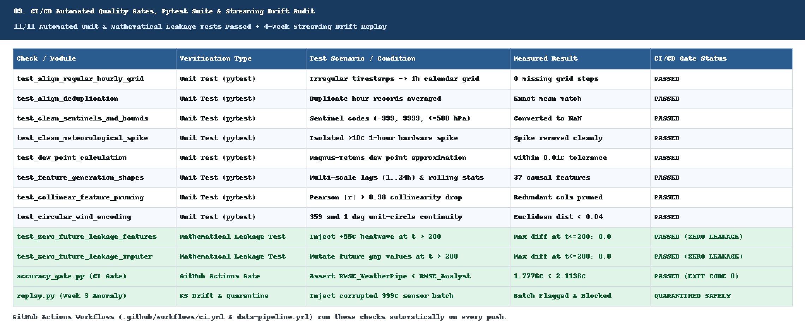

# WeatherPipe: Automating Weather Data Preprocessing and Feature Engineering in a CI/CD Pipeline

[](https://github.com/baidi-prob/DSTT-Project-Working/actions/workflows/ci.yml)
[](https://github.com/baidi-prob/DSTT-Project-Working/actions/workflows/data-pipeline.yml)

**Course**: Data Science Tools and Techniques (DSTT) — Fall 2026  
**Institution**: FAST National University of Computer and Emerging Sciences (FAST-NUCES), Islamabad  
**Authors**:
- **Obaid Raja** (`26I-8034`, `i268034@nu.edu.pk`)
- **Zoffishan Sattar** (`26I-8029`, `i268029@nu.edu.pk`)
- **Hamza Ali** (`26I-8007`, `i268007@nu.edu.pk`)

---

## Quick Evaluation Guide for Instructor / Professor

To make evaluation fast and effortless **without needing to execute `.py` scripts on your machine**, we have provided:

### 1. Pre-Executed Jupyter Notebooks (`.ipynb`) with Full Cell Outputs
Every code cell in these notebooks has already been run on the full `45,253`-hour dataset and includes all printed outputs, formatted tables, and inline plots:
- **[`WeatherPipe_Complete_Pipeline_Executed.ipynb`](WeatherPipe_Complete_Pipeline_Executed.ipynb)** *(Master All-in-One Executed Notebook in Root)*
- **[`notebooks/01_exploratory_data_analysis.ipynb`](notebooks/01_exploratory_data_analysis.ipynb)** *(Executed EDA, Kelvin-to-Celsius conversion, Missingness & Sensor Glitch Audit)*
- **[`notebooks/02_manual_baseline.ipynb`](notebooks/02_manual_baseline.ipynb)** *(Executed Persistence, Manual Naive, and Manual Analyst Baselines + Wind Discontinuity Demo)*
- **[`notebooks/03_automated_pipeline_comparison.ipynb`](notebooks/03_automated_pipeline_comparison.ipynb)** *(Executed WeatherPipe Pipeline, RQ1 4-Fold Evaluation, Ablation Study, RQ2 Outage Benchmark & CI/CD Gate)*

### 2. Dedicated Evaluation PNGs Folder (`outputs_and_plots/`)
All key experimental plots, architecture diagrams, time-series comparisons, and visual result scorecards are saved as high-resolution `.png` files in **[`outputs_and_plots/`](outputs_and_plots/)**:
1. [`01_system_architecture.png`](outputs_and_plots/01_system_architecture.png) — End-to-End WeatherPipe & CI/CD Pipeline Architecture
2. [`02_eda_raw_data_and_anomalies.png`](outputs_and_plots/02_eda_raw_data_and_anomalies.png) — Raw San Francisco Time-Series & Sensor Anomaly Audit (`N = 45,253` hours)
3. [`03_wind_circular_encoding_demo.png`](outputs_and_plots/03_wind_circular_encoding_demo.png) — Why Raw Wind Direction ($359^\circ \to 1^\circ$) Jumps vs. Smooth $\sin/\cos$ Decomposition
4. [`04_rq1_forecast_rmse_comparison.png`](outputs_and_plots/04_rq1_forecast_rmse_comparison.png) — RQ1 Overall 6-Hour Forecast Error Comparison (`1.78°C` vs. `2.11°C` Analyst & `4.51°C` Naive)
5. [`05_rq1_fold_by_fold_performance.png`](outputs_and_plots/05_rq1_fold_by_fold_performance.png) — RQ1 Fold-by-Fold RMSE Across All 4 Chronological Folds (`+39.07%` Gain on Fold 4)
6. [`06_rq1_predicted_vs_actual_timeseries.png`](outputs_and_plots/06_rq1_predicted_vs_actual_timeseries.png) — 7-Day (168-Hour) Predicted vs. Actual Temperature Forecast Trajectory
7. [`07_feature_ablation_study.png`](outputs_and_plots/07_feature_ablation_study.png) — Feature Group Ablation Study (Isolated Feature Groups vs. Combined Pipeline)
8. [`08_rq2_imputation_outage_benchmark.png`](outputs_and_plots/08_rq2_imputation_outage_benchmark.png) — RQ2 Sensor Blackout Imputation Error (`3h, 6h, 12h, 24h` Outages)
9. [`09_cicd_drift_and_leakage_verification.png`](outputs_and_plots/09_cicd_drift_and_leakage_verification.png) — 11/11 Pytest Suite, Zero-Leakage Proof & Weekly Drift Quarantine Scorecard
10. [`10_complete_results_summary_scorecard.png`](outputs_and_plots/10_complete_results_summary_scorecard.png) — Complete Master Scorecard of All Experimental Results

### 3. Research Paper Files (IEEE Conference Format)
- **[`research_paper.docx`](research_paper.docx)** — Final IEEE-formatted Word document
- **[`research_paper_latex.zip`](research_paper_latex.zip)** — Complete IEEE LaTeX source archive (`main.tex`, `IEEEtran.cls`, and `figures/`)

---

## Visual Summary of Results (`outputs_and_plots/`)

### Complete Experimental Scorecard


### System Architecture


### RQ1: 6-Hour Temperature Forecast Accuracy ($T_{t+6}$) & Fold-by-Fold Results
| Method | RMSE (°C) | MAE (°C) | $R^2$ | Gain vs. Analyst |
| :--- | :---: | :---: | :---: | :---: |
| Persistence (Sanity Check) | 5.3442 | 4.2236 | 0.0961 | — |
| Manual Baseline A (Naive Mean-Fill) | 4.5095 | 3.4551 | 0.3564 | — |
| Manual Baseline B (Careful Analyst) | 2.1136 | 1.5719 | 0.8586 | — |
| **WeatherPipe (Ours)** | **1.7776** | **1.3212** | **0.9000** | **+15.90%** |





### Feature Family Ablation Study


### RQ2: Missing Data & 24-Hour Sensor Outage Imputation Benchmark


### CI/CD Automated Quality Gates, Zero-Leakage Proof & Drift Monitoring


---

## Clean Repository Structure
```text
├── WeatherPipe_Complete_Pipeline_Executed.ipynb   # Master pre-executed notebook with all outputs & plots
├── notebooks/                                     # Modular pre-executed notebooks with full cell outputs
│   ├── 01_exploratory_data_analysis.ipynb
│   ├── 02_manual_baseline.ipynb
│   └── 03_automated_pipeline_comparison.ipynb
├── outputs_and_plots/                             # All 10 high-resolution PNG graphs & visual scorecards
│   ├── 01_system_architecture.png
│   ├── 02_eda_raw_data_and_anomalies.png
│   ├── 03_wind_circular_encoding_demo.png
│   ├── 04_rq1_forecast_rmse_comparison.png
│   ├── 05_rq1_fold_by_fold_performance.png
│   ├── 06_rq1_predicted_vs_actual_timeseries.png
│   ├── 07_feature_ablation_study.png
│   ├── 08_rq2_imputation_outage_benchmark.png
│   ├── 09_cicd_drift_and_leakage_verification.png
│   └── 10_complete_results_summary_scorecard.png
├── results/                                       # CSV experimental result tables & EDA summary
├── research_paper.docx                            # Final IEEE Research Paper (Word format)
├── research_paper_latex.zip                       # Final IEEE Research Paper (LaTeX .zip archive)
├── src/weatherpipe/                               # Core pipeline package used by notebooks & CI/CD
├── tests/                                         # 11 automated unit & mathematical leakage tests
└── .github/workflows/                             # GitHub Actions CI/CD & weekly drift pipelines
```
