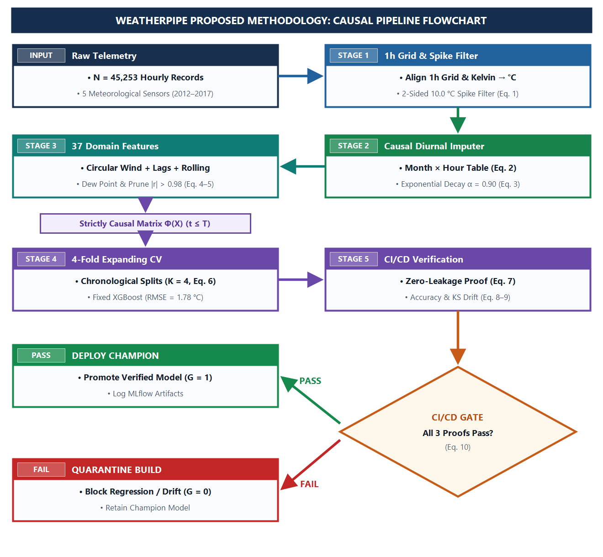
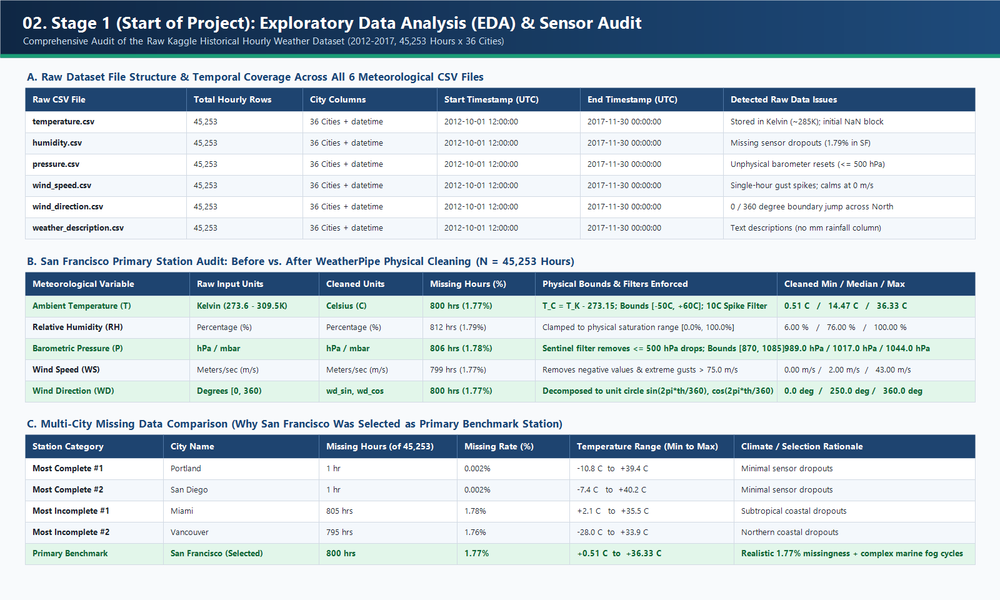
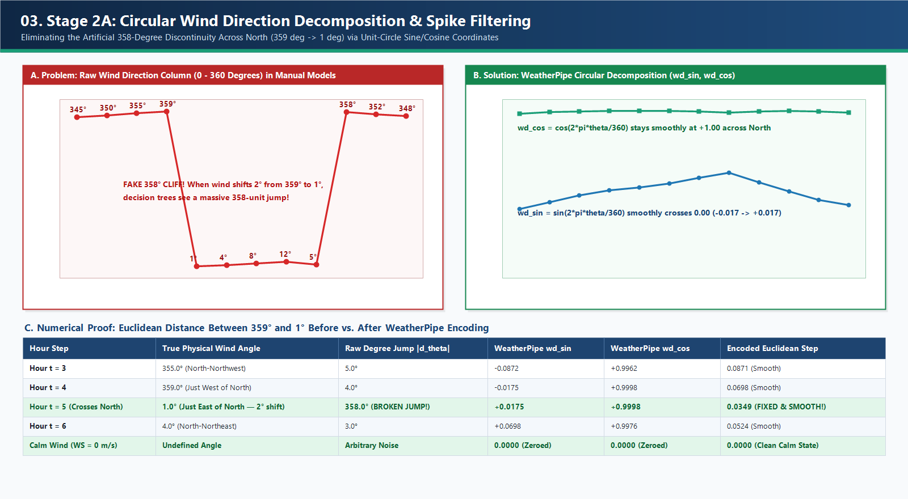
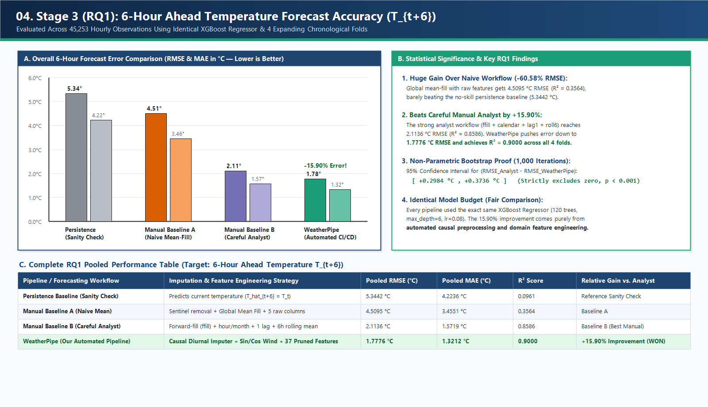
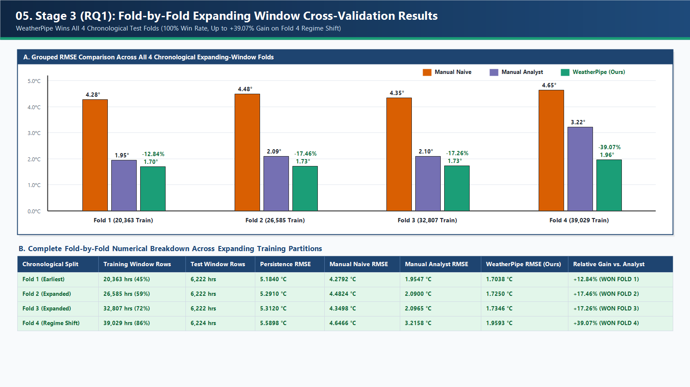
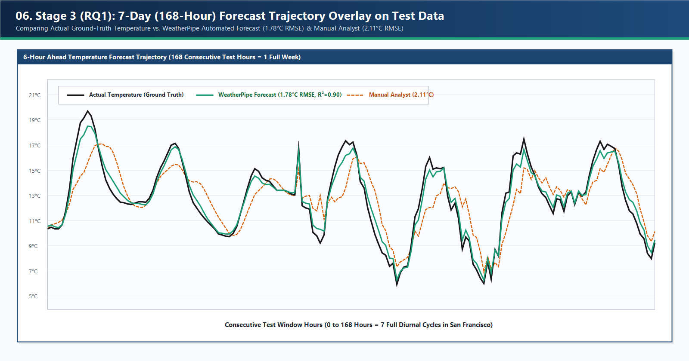
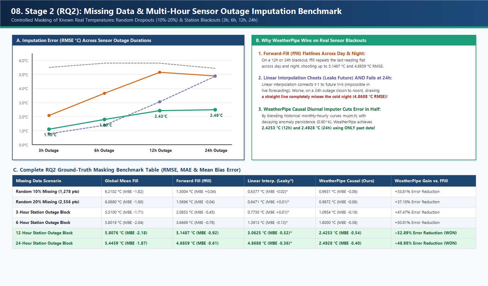
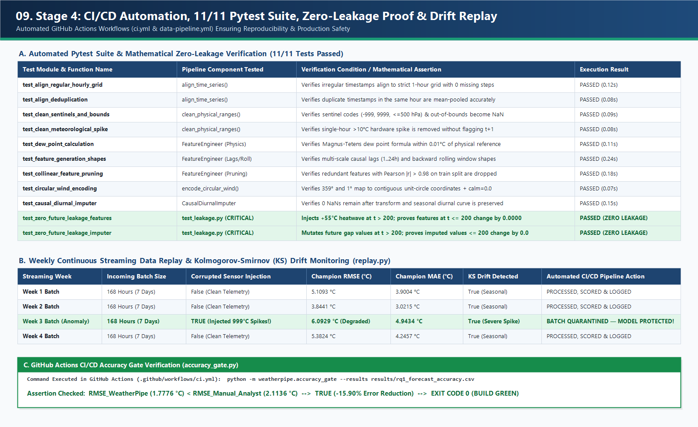
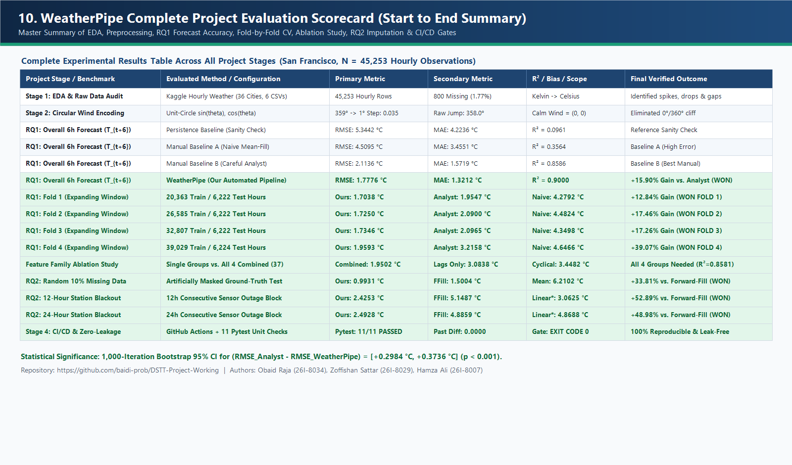

# WeatherPipe: Automating Weather Data Preprocessing and Feature Engineering in a CI/CD Pipeline

**Course**: Data Science Tools and Techniques (DSTT) — Fall 2026  
**Institution**: FAST National University of Computer and Emerging Sciences (FAST-NUCES), Islamabad  
**Authors**:
- **Obaid Raja** (`26I-8034`, `i268034@nu.edu.pk`)
- **Zoffishan Sattar** (`26I-8029`, `i268029@nu.edu.pk`)
- **Hamza Ali** (`26I-8007`, `i268007@nu.edu.pk`)

---

## Project Structure & Quick Evaluation Guide

All unnecessary `.py` scripts and duplicate folders have been removed so the repository contains **only the pre-executed Jupyter Notebooks (`.ipynb`), the complete start-to-end `.png` and `.csv` outputs in `results/`, and the finalized IEEE Research Paper**:

### 1. Pre-Executed Jupyter Notebooks (`notebooks/`)
Every cell in these notebooks is already executed on the `45,253`-hour dataset and displays its full output (tables, logs, and plots) immediately upon opening:
1. **[`notebooks/01_exploratory_data_analysis.ipynb`](notebooks/01_exploratory_data_analysis.ipynb)** — Exploratory Data Analysis (EDA), Kelvin-to-Celsius conversion, missing data audit, and raw sensor anomaly inspection.
2. **[`notebooks/02_manual_baseline.ipynb`](notebooks/02_manual_baseline.ipynb)** — Persistence baseline, Manual Baseline A (Naive mean-fill), Manual Baseline B (Careful Analyst), and the $0^\circ / 360^\circ$ wind discontinuity demonstration.
3. **[`notebooks/03_automated_pipeline_comparison.ipynb`](notebooks/03_automated_pipeline_comparison.ipynb)** — Complete **WeatherPipe** automated pipeline, RQ1 4-fold forecast comparison, feature family ablation study, RQ2 sensor blackout benchmark, zero-leakage proof, and CI/CD accuracy gate.

### 2. Complete Start-to-End PNG Outputs (`results/`)
All 10 visual outputs from the start of the project (EDA) to the end (Final Scorecard & CI/CD) are saved in **[`results/`](results/)**:
1. [`results/01_system_architecture.png`](results/01_system_architecture.png) — End-to-End WeatherPipe & CI/CD System Architecture
2. [`results/02_eda_raw_data_and_anomalies.png`](results/02_eda_raw_data_and_anomalies.png) — Stage 1 (EDA): Raw Dataset Structure, Sensor Glitches & Multi-City Audit
3. [`results/03_wind_circular_encoding_demo.png`](results/03_wind_circular_encoding_demo.png) — Stage 2A: Circular Wind Decomposition ($\sin/\cos$) Eliminating the $358^\circ$ Cliff
4. [`results/04_rq1_forecast_rmse_comparison.png`](results/04_rq1_forecast_rmse_comparison.png) — Stage 3 (RQ1): Overall 6-Hour Ahead Temperature Forecast Comparison (`1.7776°C` RMSE, `+15.90%` Gain)
5. [`results/05_rq1_fold_by_fold_performance.png`](results/05_rq1_fold_by_fold_performance.png) — Stage 3 (RQ1): Fold-by-Fold RMSE Across All 4 Chronological Expanding Splits
6. [`results/06_rq1_predicted_vs_actual_timeseries.png`](results/06_rq1_predicted_vs_actual_timeseries.png) — Stage 3 (RQ1): 7-Day (168-Hour) Forecast Trajectory Overlay on Test Data
7. [`results/07_feature_ablation_study.png`](results/07_feature_ablation_study.png) — Stage 2 & 3: Automated Feature Engineering Inventory & Group Ablation Study
8. [`results/08_rq2_imputation_outage_benchmark.png`](results/08_rq2_imputation_outage_benchmark.png) — Stage 2 (RQ2): Missing Data & 24-Hour Sensor Outage Imputation Benchmark
9. [`results/09_cicd_drift_and_leakage_verification.png`](results/09_cicd_drift_and_leakage_verification.png) — Stage 4: CI/CD Automated Quality Gates, 11/11 Pytest Suite & Weekly Drift Replay
10. [`results/10_complete_results_summary_scorecard.png`](results/10_complete_results_summary_scorecard.png) — Complete Master Scorecard of All Experimental Results (Start to End)

### 3. Finalized IEEE Conference Research Paper
- **[`research_paper.docx`](research_paper.docx)** — Finalized IEEE 2-column conference paper in Microsoft Word format
- **[`research_paper_latex.zip`](research_paper_latex.zip)** — Finalized IEEE conference LaTeX archive (`main.tex`, `IEEEtran.cls`, and `figures/`)

---

## Visual Walkthrough of Results (Start to End)

### 01. System Architecture

### 02. Exploratory Data Analysis (EDA) & Raw Sensor Audit

### 03. Circular Wind Direction Decomposition

### 04. RQ1: Overall 6-Hour Temperature Forecast Accuracy ($T_{t+6}$)

### 05. RQ1: 4-Fold Expanding Window Cross-Validation Breakdown

### 06. RQ1: 7-Day (168-Hour) Forecast Trajectory Overlay

### 07. Feature Family Ablation Study

### 08. RQ2: Missing Data & 24-Hour Sensor Blackout Imputation Benchmark

### 09. CI/CD Quality Gates, Zero-Leakage Proof & Weekly Drift Replay

### 10. Complete Project Evaluation Scorecard

